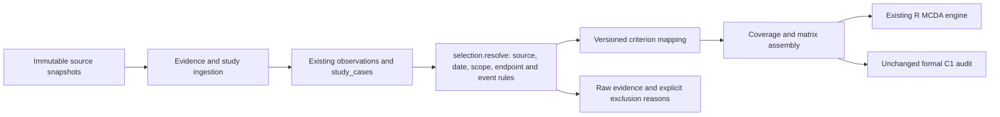

# Phase 7 evidence integration

The same SQLite store, Python CLI and R engine now share a versioned evidence-selection result. The SQLite schema is unchanged; no second commercial table or research database was introduced. The operational database remains `work/phase5/canonical.sqlite`.

## Data flow and compatibility

Previously, `analysis.prepare()` overwrote observations by variable/date, `studies.prepare()` selected study cases independently, and `official.domain_evidence_coverage()` maintained a separate variable whitelist. That could describe raw evidence as scorable without reproducing the matrix selection.

Current flow:



Only one new production module, `selection.py`, is added. It owns semantic selection, raw-domain taxonomy and candidate criterion mapping. `validate_pages()` in the existing evidence module now serves observations, study cases and events. The existing national raw-domain report uses the same taxonomy. Matrix assembly and the existing R methods remain in their original modules. `tools/check_replay.py` is a verification tool, not an analysis pipeline.

The current CLI loads `config/evidence_policy.json` into the recorded research configuration. A snapshot lock restores its adjacent, checksum-checked `configuration.json`; Phase 5/6 retain the old selection semantics. The current conflict resolver does not rewrite old observations to REVIEW. Old policy behavior remains available only for historical reconstruction. Resource statements are grouped by source and scope before selection; a later different deposit scope cannot replace an earlier one.

## Shared evidence contract

Every candidate retains original evidence IDs, source SHA, physical PDF page, locator, effective/publication/availability dates, unit, basis, scope and extraction metadata. Month/year precision uses the end of that period conservatively. Future or expired events, source/hash mismatches and missing page bindings are isolated. An unavailable current source does not erase a retained original.

Latest-date selection occurs only within the same semantic scope/instrument. Same-date conflicting values produce Missing; identical corroboration retains all IDs. Different study IDs, feeds, REO bases, endpoints, scales and resource scopes are not interchangeable. Composition must match the selected resource statement, source, scope and date. A SITE/DEPOSIT/ISSUER observation is not rolled up to a Project by name or proximity.

`resolved_evidence.csv` exposes individual extraction versions; `technical_commercial_coverage.csv` counts distinct scientific evidence as well as versions. Raw entities include government sites and corporate issuers and are explicitly distinguished from Project groups. Numeric statements exclude NULL commercial events.

## Technical integration

All nine existing engineering cases and 40 parameters enter the shared query contract: 34 Technical parameters and six Commercial parameters. Mineralogy, flowsheet text, feed, endpoint, scale and NORM observations retain their original scope.

- Browns Range and Yangibana: DFS whole-ore TREO to mineral concentrate, TC1/TC2; two-case endpoint panel retained.
- Jupiter: Scoping MREC model and process-design alternative remain separate quantities.
- Dubbo: three Nd mining-zone leach inputs remain a model-zone range, not random measurement error or plant recovery.
- Cowalinya: selected 45-composite diagnostic leaching and the separate one-kilogram concept blend remain different cases.
- Circle Valley: five-composite bench leach is not resource-average recovery.
- Koppamurra: 68% PFS mine-plan to calcined mixed REO remains separate from concentrate, MREC, leach solution and separated oxides.

V2 T1 remains recovery; upstream legacy T1 processing complexity is explicitly not an alias. The conservative candidate T1 endpoint/scale contract is not an approved formal-panel definition. No processing-complexity ordinal is adopted: counting operations does not establish cost, difficulty, reagent intensity or NORM burden. T1 still has zero comparable candidates; seven Project groups have related but incompatible recovery evidence, while 24 have no compatible recovery variable.

TC1/TC2 have two eligible Project groups. Their intersection with the validated resource cohort is only one: Yangibana has no admitted comparable resource statement. The new resource/concentrate matrix therefore has no MCDA ranking (n=1), rather than being padded.

## Commercial integration

Twelve source/page-verified disclosures are stored as `commercial_event` in the existing observation table, with numeric value NULL. They cover Jupiter, Yangibana, Dubbo, Nolans, Goschen and Donald. Financing, offtake and a historical payment are distinct event types. The source amount, legal agreement state, conditions, facility/contract ID, effective date, explicit validity and currentness remain in raw JSON.

The exploratory codebook describes a **dated disclosed financing milestone**, not available funds, percentage financed or probability of development: 0 explicit no financing; 1 proposed/nonbinding support; 2 conditional commitment/approval; 3 full project financial close; 4 evidenced drawdown. Unknown is Missing, never zero. Conditional credit approvals and signed conditional agreements remain legally different evidence types even where the exploratory ordinal is equal. This ordering has not been scientifically or expertly ratified and never grants formal C1 admission.

Selection is per instrument before checking validity: a later expired, terminated or unsupported status cannot resurrect an earlier pledge. Actual close/draw states require satisfied conditions. Corporate equity, CAPEX, offtake and a paid exclusivity fee cannot automatically establish full Project financing. Undisclosed expiry remains unknown; the historical milestone does not certify present availability.

Nolans retains conditional credit approvals, equity/documentation conditions and undisclosed exact expiry dates. Goschen retains both note tranches and their separate conditions. Same-date Iluka take-or-pay and VHM take-and-pay terms are automatically flagged as an offtake payment-terms conflict; neither wording establishes disbursement. Donald retains the dated binding JV/earn-in, FID-dependent offtake and separately reported A$1.5m historical exclusivity payment, without treating the entire A$183m earn-in as paid.

Six Project groups have a candidate financing milestone. Four intersect the resource-defined cohort: Dubbo, Goschen, Nolans and Jupiter. The new resource/financing panel uses existing scenario weights and R methods. It is an exploratory comparison of resource inventory and disclosed milestones, not financial adequacy or a six-domain development ranking.

## Actual database and analytical increment

| Measure | Phase 6 | Phase 7 |
|---|---:|---:|
| Canonical PROJECT registry groups |31|31|
| Government REE native records |704|712|
| Comparable resource cases |19|19|
| Selected snapshot entries / PDFs |75 / 38|76 / 38|
| Distinct validated numeric statements |114|114|
| Structured verified commercial events |0|12|
| Technical numeric observations / engineering parameters |11 / 34|11 / 34|
| Commercial numeric observations / engineering parameters |14 / 6|14 / 6|
| Shared TC1/TC2 eligible groups |2 in separate case path|2 in shared selection|
| Candidate financing-milestone groups |0 mapped|6|
| Resource/financing panel |absent|4|
| Resource/concentrate intersection |absent|1, no ranking|
| Formal C1 / strict Development / full evidence |0 / 0 / 0|0 / 0 / 0|

The common main-code coverage is R19/S8/T0/D4/I19/C6, with C6 explicitly a candidate dated milestone. TC1/TC2 eligibility is separate from T1. The six existing panels retain sample sizes 19/7/8/4/2/17 and identical scientific results when their evidence is unchanged.

The newly acquired QLD MINOCC layer12 contains 21,380 original records and 44 archived API responses. Twenty match the existing REE/mineral-indicator filter; twelve reuse existing occurrence SITE IDs, giving eight new SITE IDs and no new certified Project. The source-reported REE-related rows include 12 occurrences, seven abandoned mines and one operating mine; an incidental REE commodity does not establish an economic REE Project. Total raw rows across selected state source inventories are 144,077, including overlap between QLD layers12/17. This sum is not a distinct physical entity count. Native site IDs and raw attributes preserve that overlap.

All previous 40 unresolved deposit pairs, three primary-document gaps and the 31 registry groups remain explicit. No name/proximity merge is introduced.

For Aim A, all three methods put Jupiter first in the resource-weighted new financing panel, and Nolans first in the development/strategic scenarios. These are conditional two-criterion candidate results. Aim B reruns weights, methods, rounding, scoring functions, leave-one-criterion and cohort sensitivity without invented measurement errors. The new four-case panel has method Spearman agreement of 1 in all three scenarios. In the specified 1,000-draw preference experiment, first-place frequencies are Jupiter 95.2% in the resource scenario and Nolans 100%/95.8% in the development/strategic scenarios; these are model frequencies, not financing or development probabilities. Aim C keeps descriptive host-type/development/GIS analyses; this increment supplies neither a new geological mechanism nor grounds for causal inference.

## Reproduction and limitations

```powershell
$env:PYTHONPATH='src'
python -m au_ree_v2 all --as-of 2026-11-03 --compare-to results/phase6-2026-11-03 --work work/phase5
python -m au_ree_v2 rebuild --as-of 2026-11-03 --snapshot-lock results/phase7-2026-11-03/snapshot_lock.json --work work/phase7-replay
python tools/check_replay.py results/phase7-2026-11-03 work/phase7-replay/latest.json
python -m unittest discover -s tests -v
Rscript tests/test_methods.R
```

The SQLite schema, original IDs and six formal C1 gates are unchanged. Phase 5/6 each have 24 scientific matrix/ranking/criteria/weight files compared against frozen outputs. CI reconstructs November2, Phase5, Phase6 and Phase7 and explicitly verifies the frozen scientific outputs. The Python suite adds real-document integration, same-date/scope conflict, endpoint/scale, corporate attribution, expiry/termination, cutoff, repeated ingestion, policy-lock tampering and QLD native-ID regressions to the original 69 tests.

No new primary PDF or numeric measurement is claimed in this phase. The added events structure existing original disclosures. Shared overall recovery, a validated processing-complexity score, actual current financing availability, exact Nolans credit expiry dates and an approved formal panel remain unavailable. Splinter/Wudinna/Kalkaroo originals, Yttria footprint reconciliation, state tenement coverage and exhaustive issuer updates remain outstanding. Frozen results and retained private credential-bearing originals are untouched; public snapshots/exports retain the established redaction rules.
