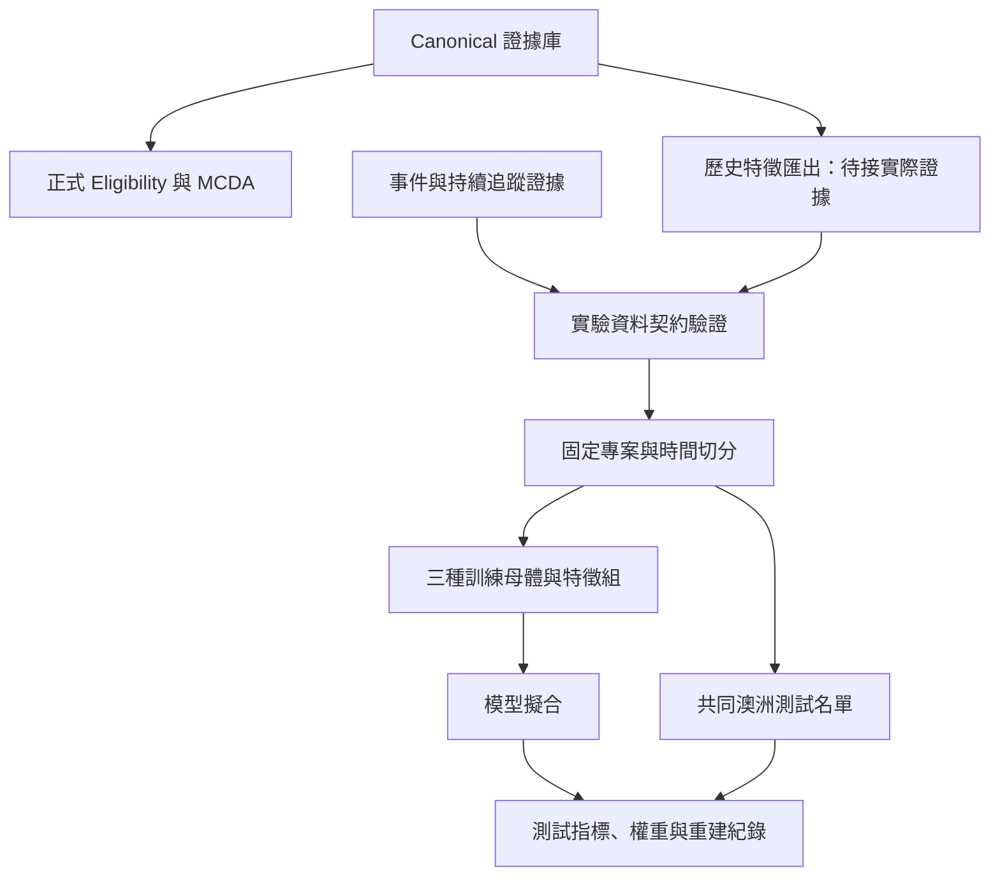

# 可重建的 ML／MCDA 實驗層

本模組在現有來源、證據庫與正式 MCDA 流程之外，加入讀取已驗證資料的實驗入口，用來測試「全球資料是否改善澳洲預測」、「NLP 衍生特徵是否有額外資訊」及「固定準則尺度下，能否從實際開發事件學到 MCDA 權重」。目前提供可執行的合成示範；真實資料必須先通過下述輸入契約。

## 架構與責任

| 層次 | 現有或新增模組 | 責任 |
|---|---|---|
| 原始證據與實體 | `store.py`、`evidence_model.py`、`selection.py`、`selection_rules.py` | 沿用 canonical SQLite、穩定 Project ID、來源快照、語義相容與選值規則 |
| 正式研究分析 | `analysis.py`、`mcda.py`、R 分析 | 沿用正式 Eligibility、研究權重與敏感度分析 |
| 實驗資料契約 | **`experiment_data.py`** | 驗證 Project × 時點資料、來源時間、首次事件、追蹤期及缺值狀態 |
| 實驗切分與執行 | **`experiments.py`** | 凍結澳洲測試名單，選擇三種訓練母體，記錄切分及輸出指紋 |
| 模型介面 | **`experiment_models.py`** | 固定 MCDA、事件先驗、logistic 與可學習 MCDA；只用訓練資料擬合 |
| 配置 | **`config/experiments/*.json`** | 宣告目標事件、預測期間、特徵組、切分、模型與隨機種子 |



實驗入口不寫入 canonical database，也不改正式研究設定。它接收的 JSON 是具有版本指紋的衍生輸入，不作為第二個正式證據庫。新模組採現有平面套件結構，並受既有模組相依 DAG 測試約束。

## 執行

在 repository 根目錄安裝原本依賴及選用的實驗依賴：

```bash
python -m pip install -e ".[experiments]"
```

檢查合成示範的輸入與切分，不擬合、不寫檔：

```bash
python -m au_ree_v2 experiment \
  --experiment-config config/experiments/synthetic_demo.json \
  --dry-run
```

執行合成示範：

```bash
python -m au_ree_v2 experiment \
  --experiment-config config/experiments/synthetic_demo.json \
  --out work/experiments/synthetic-demo-v1
```

示範含 25 筆虛構時點紀錄、24 個虛構專案，並使用明示為合成的來源 ID 與 SHA。三種訓練母體 × 四種模型共有 12 個變體，全部共用三筆澳洲測試案例。其數值只驗證程式，不估計任何真實專案的開發潛勢。

檢查真實資料準備情況：

```bash
python -m au_ree_v2 experiment \
  --experiment-config config/experiments/au_transfer.json \
  --dry-run
```

`au_transfer.json` 是研究設計範本：以 FID 為事件、1095 天為固定期間，並使用 2026-11-13 作為**範本資料截止日**。它不宣稱對應歷史快照已存在。缺少 `data/experiments/project_time_cases.json` 時，結果為 `BLOCKED / VERIFIED_PROJECT_TIME_DATASET_REQUIRED`；不會自動換成合成資料。非 dry-run 的完全 BLOCKED 執行會寫入原因報告並以 exit code 2 結束；PARTIAL 必須逐一檢查 blocked variants，不能當成全部成功。

輸出為不可覆寫的兩個檔案：

- `experiment_report.json`：配置、程式與輸入 SHA、實體對照版本、排除原因、測試名單、訓練 ID、模型參數與指標。
- `predictions.csv`：個別案例的事件機率、學得 MCDA 分數或既有 MCDA 的分數／排名範圍。

相同程式、資料與配置可重跑至同一資料夾；若內容不同，必須使用新的輸出位置。跨程式版本重跑也應使用新位置。

## Project × 時點的輸入契約

完整可讀範例見 `tests/fixtures/experiment_synthetic.json`。頂層包含 `schema_version="experiment-dataset-v1"`、明確的 `synthetic` 布林值、`identity_map_sha256` 與 `cases`。

| 欄位 | 用途與限制 |
|---|---|
| `case_id` | 唯一實驗案例 ID；同一 Project／as_of／scope／target 不得換 ID 重複加入 |
| `project_id` | 沿用 canonical ID；不因國家、排序或資料匯入重新編號 |
| `country`、`commodity` | ISO3 格式國家碼與明確礦種群；必須由上游來源支持，不由交易所或公司所在地推定 |
| `scope` | v1 僅接受 PROJECT；礦床數值須先處理聚合、母子關係及重複資源 |
| `as_of` | 這一列作出預測時允許知道資訊的日期 |
| `at_risk` | 上游已確認當時仍有可能首次發生該事件；已發生事件的案例另行排除 |
| `features` | 有限數值或 null；未揭露或無法判定維持 null |
| `lineage` | 每個非空特徵附 observation IDs、來源 SHA、locator、known_at、known_at_basis、effective_date、unit、basis |
| `outcome` | 目標、狀態、事件日、公布日、追蹤截止日、來源 SHA 與 locator |

必須區分三種日期：`effective_date` 是數值所描述的有效日；特徵 `known_at` 是能證明資訊已公開或已被封存的日期；`as_of` 是預測時點。特徵的前兩者都不得晚於 `as_of`。結果的 `known_at` 可以晚於預測時點，但進入訓練時必須早於或等於訓練截止日。

`known_at_basis` 只接受 `VERIFIED_PUBLICATION` 或 `ARCHIVED_CAPTURE`。今天下載文件不等於歷史時點已取得該內容；現有 acquisition 的歷史限制與來源證明政策維持有效。本框架**不重開 PDF 或重新核對原始來源 SHA 的 bytes**，只檢查匯出契約與時間一致性，報告會標明 `source_documents_reverified=false`。真實來源驗證必須由上游完成。

同名特徵的非空數值必須使用相同 unit 與 basis。跨國報告基準仍須先完成語義對照；不能僅改寫 JORC、NI 43-101 等標籤就視為等價。MCDA 類模型另檢查輸入單位與固定評分定義完全相同。

## 結果標籤與追蹤期

v1 是「預測時點之後固定期間內，是否首次發生指定事件」的二元實驗，尚未實作存活分析。

- `OBSERVED`：完整事件日期與有效來源已驗證；期間內發生為 1。事件已在 `as_of` 前發生時，排除該案例。
- `NO_EVENT_VERIFIED`：明確追蹤至期間末，且追蹤證據已可用，才能成為 0。
- `UNKNOWN`、`CENSORED`、`PLANNED`：保留未標記；未找到公告、尚未滿追蹤期或公司預定日期都不當成 0 或真實事件。

日期只有年或月時不猜成完整日期。不同快照對同一 Project／target 的首次事件日必須一致；影響其他快照的已發生判定還需來源完整，且事件日 ≤ 公布日 ≤ 評估截止日。未通過來源／時間檢查的事件不得污染其他快照。

訓練與測試都只使用已完整走完固定期間的案例，包括很早就成為正例的案例；這避免只納入尚未成熟時窗中的早期正例。未知與未成熟案例的數量、排除原因及測試標籤覆蓋率均保留，不能只報成功標記樣本的準確度。

## 可比較的三種訓練母體與三種切分

| 訓練母體 | 內容 | 可回答的問題 |
|---|---|---|
| `AU_REE` | 澳洲稀土 | 本地資料的預測基準 |
| `GLOBAL_REE` | 全部國家的稀土 | 同礦種跨國資料是否改善澳洲結果 |
| `GLOBAL_REE_PLUS_OTHER` | 全部稀土加配置明列的其他礦種 | 額外礦種是否提供可轉移資訊 |

同一 split 內，三組使用**完全相同的測試案例、標籤、特徵定義和評估日**。測試 Project 名單先按指定 ID 或固定種子產生，再檢查標籤。特徵組比較也使用同一份驗證後母體，避免新增 NLP 欄位時悄悄換測試樣本。

跨礦種比較需使用語義可相容的共同特徵。真實資料範本以 `cohort_feature_sets` 將 `GLOBAL_REE_PLUS_OTHER` 限制為 `stage_only` 與 `shared_development`（開發階段、港口距離、融資、許可），仍須由來源確認定義相容；稀土資源量 R1、磁性稀土占比 S1 及稀土文件清單定義的 T1 不直接移植至純銅／鋰專案。不適用的特徵不能僅填 null 後由中位數補成稀土值。未核准的組合會記錄 `FEATURE_SET_NOT_APPROVED_FOR_COHORT`。合成示範的全部欄位均為虛構，其完整計算格只示範軟體介面，不提供跨礦種語義證明。

| split mode | 時間／群組規則 | 評估的泛化範圍 |
|---|---|---|
| `new_project` | 時間向前切分；測試 Project 的所有歷史列都不得進訓練 | 尚未見過的澳洲專案 |
| `future_project` | 時間向前切分；允許同一 Project 的更早資料 | 已知專案的未來狀態 |
| `leave_country` | 排除目標國所有訓練列 | 對未參與訓練國家的遷移 |

訓練列還須滿足 `horizon_end <= train_cutoff` 及 `label_available_at <= train_cutoff`。`leave_country` 以澳洲為目標時，AU_REE 訓練母體必然為空，該組學習模型會明確 BLOCKED；這是設計結果。

目前全球模型使用 pooled baselines，尚未實作國家分層模型、領域加權或國別校準，因此只能提供比較實驗，不能預先保證跨國資料有益。未來若選模型或調參，需另設時間／Project 分組的內層驗證；凍結的外層測試集不可用來反覆選模型。

## 模型與解讀

| 模型 | 做法 | 輸出的意義 |
|---|---|---|
| `prior` | 訓練樣本的事件比例 | 基準事件機率 |
| `logistic` | 訓練中位數、缺值指標、標準化與固定超參數 logistic | 無單調限制的事件機率 |
| `fixed_mcda` | 沿用研究尺度與權重，計算 SAW、TOPSIS、PROMETHEE II | 決策效用與測試 panel 的排名範圍 |
| `outcome_mcda` | 固定準則尺度、訓練中位數補值、非負係數 logistic | 由事件結果擬合的加性 MCDA 分數及事件機率 |

`outcome_mcda` 使用既有 `mcda.score()` 將特徵轉為效用 `u_j(x)`，擬合：

$$
p(x)=\sigma\left(b+\sum_j\beta_j u_j(x)\right),\qquad \beta_j\geq 0.
$$

目標函數為平均 log loss 加 `0.5 × 0.01 × Σβ²`；截距不懲罰，L2 係數事先固定。當 `s=Σβ` 大於數值容許值時，報告 `w_j=β_j/s`、`MCDA_score=Σw_j u_j(x)`，因此 `p=σ(b+s×MCDA_score)`。若係數總和接近零，報告無方向性訊號與空權重，不製造一組看似有意義的權重。

這些權重表示在指定事件、期間、樣本與單調假設下的預測關聯。它們不等於專家偏好、公共政策價值或因果影響。若準則有高度相關性，即使預測穩定，個別權重仍可能不穩定；未來應以 Project 分組 bootstrap 另檢查。

`fixed_mcda` 對缺值沿用 `[0,1]` 效用集合，輸出保守範圍；它的分數不送入 Brier 或 log loss。排名單位是這次測試的 **case**；多日期的 case 混合排名不可當作某一日期的全澳正式專案排名。比較正式排序仍應沿用原來的年度／同時點研究 panel。

事件機率模型回報 Brier score、log loss、ROC AUC、訓練／測試列數及獨立 Project 數。單一類別測試集的 AUC 標為未定義。現階段採 case 等權，沒有實作 Project 層級信賴區間，重複快照的列數不得宣稱為獨立樣本數。

## NLP 與新增特徵的位置

既有文件擷取應先輸出可驗證事實，再進 `features`；例如許可狀態、試驗尺度、承購狀態或冶金資訊。`nlp_enriched` 是已擷取特徵的對照組名稱，**不表示本次已訓練 NLP 模型**。NLP 擷取本身需另一份人工覆核的欄位／段落標註集，用 precision、recall、數值／單位／否定語句正確性驗證。

範本以 `permit_granted` 示範額外特徵：1 必須有已核發證據，0 也須有明確當時尚未核發的狀態證據，未提及維持 null。`additional_utility_criteria` 可為新特徵宣告固定尺度與單位，但禁止覆寫正式準則。這份定義只是實驗假設，不改研究六構面。

`stage_only`、`shared_development`、`six_criteria`、`nlp_enriched` 可在核准的訓練母體間比較特徵增益。原始 `fixed_mcda` 僅接受既有完整六構面，每構面一個準則；它對準則子集或額外 NLP 欄位會 BLOCKED，避免默默重分配正式權重。`outcome_mcda` 可使用明確註冊尺度的子集或額外準則。

T1 目前表示 **Technical Disclosure Transparency**，不能將學得權重解讀為實際冶金表現或技術可行性的因果證據。

## 真實資料目前的缺口與後續順序

本次以基底 commit `8b5ac86ef0ff24999c503b4268586274c10fe9ca` 的具名目錄進行準備度檢查：`data/candidate_milestone_evidence.json` 有 23 筆事件、19 個 Project，4 筆非空事件日期，0 筆完整日精度日期，目錄內沒有 FID 或 MAIN_CONSTRUCTION；`data/study_cases.json` 有 9 個案例，其語義不等同實際營運結果。這是**上述目錄的盤點**，不推論整個資料庫或所有 PDF 都沒有其他證據。

下一步依資料風險處理：

1. 從現有 evidence read model 與選值規則實作歷史特徵 exporter，接上可證明的來源可用日與實體關係版本；不得用今天的數值回填過去。
2. 建立 FID／開工／投產等各自明確定義的事件集、首次發生規則與持續追蹤證據。月份／年份精度需規劃區間時間契約，不能猜日期通過 v1。
3. 對照跨國報告的單位、REE／REO basis、資源分類、開發階段、專案角色及國家／礦種來源，再產生三種訓練母體。
4. 先跑低複雜度基準與 NLP 特徵消融，檢查同一澳洲測試集的誤差差異。資料量允許後再加入分組 bootstrap、分層／遷移模型與時間外部驗證。
5. 若要學專家偏好，另外蒐集配對比較或排序標註，建立獨立 task 與 label contract；不要以目前研究者假設權重產生的排名充當獨立真實結果。

Aim A 可由預測與 MCDA 的並列結果補充；Aim B 可新增訓練母體、特徵與模型選擇的敏感度；Aim C 可比較學得關聯及其穩定性，但機制解釋仍需地質／工程證據。

## 驗證範圍

```bash
python -m unittest discover -s tests -p 'test_experiment*.py'
python -m unittest discover -s tests -p 'test_module_dependencies.py'
```

測試針對會造成研究誤判的風險：跨專案或跨時間洩漏、重複快照、未驗證事件污染、未知標籤被當成負例、測試資料參與補值、單位不一致、非負權重與方向、共同測試名單及不可覆寫的重建結果。合成案例通過只證明這些軟體契約，不能證明真實樣本的預測效度。

方法參考：[scikit-learn Common pitfalls — data leakage and preprocessing](https://scikit-learn.org/stable/common_pitfalls.html)。
