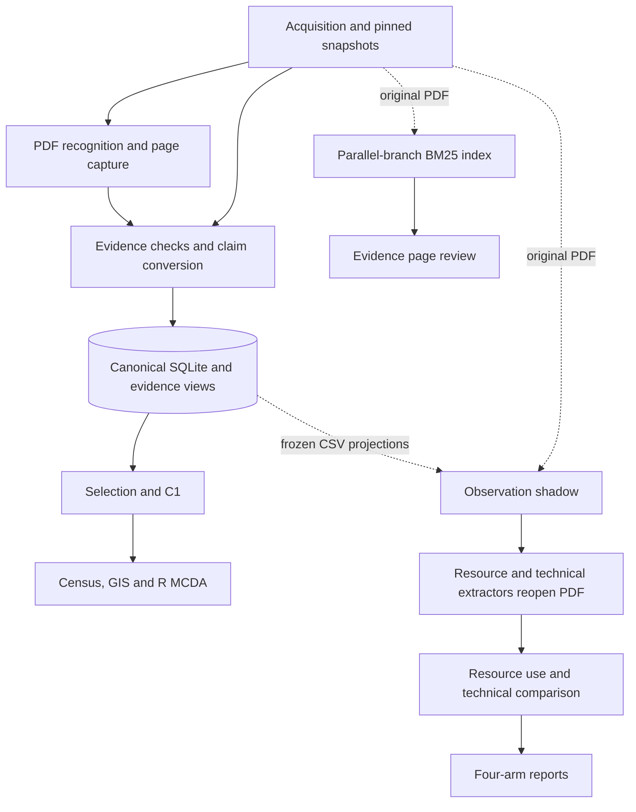
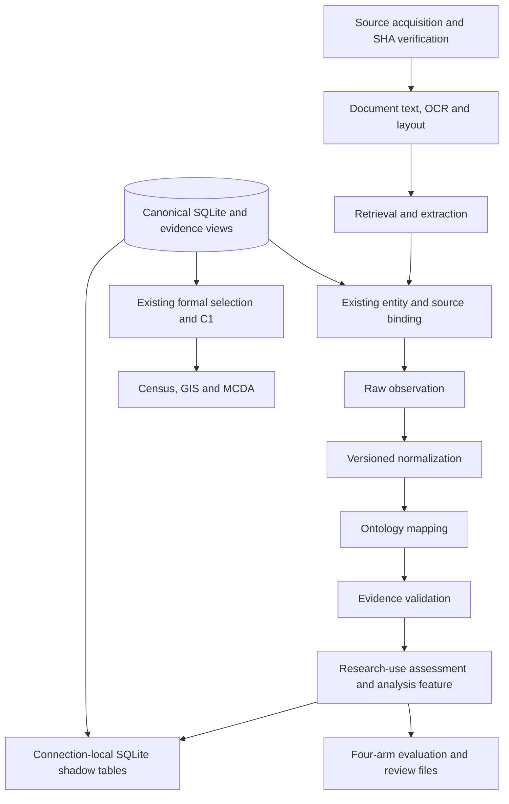

# 統一觀測資料契約與語義流程

## 開發基準

以 `feat/observation-semantics-shadow-20261126` 的 `bd6d95d` 為基準。PR #17 接續 #16 與 #15，並承接整合證據模型 #13。GitHub 對該次提交完成 Python、R、凍結重建及乾淨公開資料建置。[PR #17](https://github.com/lleeoo0611-stack/AU_REE_V2/pull/17) · [研究重建](https://github.com/lleeoo0611-stack/AU_REE_V2/actions/runs/45809715236) · [乾淨建置](https://github.com/lleeoo0611-stack/AU_REE_V2/actions/runs/45809715178)

| 既有分支 | 核對時的提交 | 已有能力 |
|---|---|---|
| `feat/integrated-evidence-model-20261120` | `25c2157` | SQLite 證據關係、聲明版次、C1 與分析接線 |
| `feat/ontology-comparability-20261126` | `cc36d77` | 來源綁定的本體論與比較原型 |
| `feat/ontology-gain-validation-20261126` | `d993ebd` | 全 Census 資源候選、審查證據與四組對照 |
| `feat/observation-semantics-shadow-20261126` | `bd6d95d` | 資源與技術完整擷取、用途判定、正式離線重播驗收 |
| `test/phase22-normalization-20261125` | `76b429a` | BM25 檢索與 Census 配對實驗 |

`bd6d95d` 包含 `25c2157`。正規化試驗分支與 `bd6d95d` 於 `8b5ac86` 分岔，BM25 實驗及其標註留在該分支。`main` 當時指向最初提交 `a16df75`。[分支比較](https://github.com/lleeoo0611-stack/AU_REE_V2/compare/76b429a8449acd3f34a952b6dce2fa95a8a2a937...bd6d95d0f30f2cb00f0b7715b18ac833899cd17a) · [BM25 封存實驗](https://github.com/lleeoo0611-stack/AU_REE_V2/tree/76b429a8449acd3f34a952b6dce2fa95a8a2a937/results/nlp-census-ab-20261126)

## 重構前



- 文件層已有來源指紋、OCR、頁擷取與 `capture_documents` 快取。驗證、資源擷取及技術擷取仍各自打開 PDF。文字排序、版面區塊與表格網格也由各入口分別取得。OCR 證詞、PyMuPDF 原生文字和 pypdf 文字有各自的查核用途。[PDF 擷取](../src/au_ree_v2/pdf_extract.py) · [資源擷取](../src/au_ree_v2/semantic_resource.py) · [技術擷取](../src/au_ree_v2/semantic_technical.py)
- `evidence.normalize`／`transformation_issues` 檢查聲明及轉換關係。`resource_use` 驗證來源 token、已入庫值與公布值，另列描述性用途中允許的換算。`technical_tables` 管理儲存格、表頭、數值和量別。選值及技術擷取共用 `technical.py` 內的 `technical_compare` 函式。[證據核驗](../src/au_ree_v2/evidence.py) · [資源用途](../src/au_ree_v2/resource_use.py) · [技術表格](../src/au_ree_v2/technical_tables.py) · [技術比較](../src/au_ree_v2/technical.py)
- SQLite 的 `observations` 已有穩定的 `obs_id` 和 `entity_id`、來源 SHA、原始 JSON、聲明、範圍、定位及轉換版本。`evidence_model` 已提供資源事實與版次、關係時間、技術試驗及公司／產品揭露的讀取 View。各讀取格式對原始欄位的命名與粒度不同，且既有觀測資料列只有一組數值和狀態。[SQLite](../src/au_ree_v2/store.py) · [證據讀取模型](../src/au_ree_v2/evidence_model.py)
- `observation_semantics` 已能分用途回傳判定、理由、證據及缺項。`ontology` 的 SKOS／QUDT 對照與 RDF／SHACL 原型、影子用途規則、正式 C1 和 MCDA 分屬不同入口。資源成對關係及技術用途的結論原先從各自的字典格式讀取。[影子規則](../src/au_ree_v2/observation_semantics.py) · [本體論原型](../src/au_ree_v2/ontology.py) · [正式選值](../src/au_ree_v2/selection.py) · [分析](../src/au_ree_v2/analysis.py)

以套件內 `.py` 檔案為節點、不同模組間的 AST 內部匯入為邊，並計入函式內匯入，基準有 **51 個模組、180 條邊、0 個循環**。`cli.py` 連到 25 個模組，兼管取得、建庫、研究出表與影子調度。正式工作流目前也需要以 `rebuild` 保持歷史快照相容。[循環測試](../tests/test_module_dependencies.py) · [重建工作流](../.github/workflows/research.yml)

## 重構後



| 層級 | 新的介面或重用點 |
|---|---|
| 文件處理 | `document_processing.PdfDocumentCache` 以 SHA 核對原件，在同次擷取共用已開啟的 PDF、文字順序、區塊、字詞及表格視圖。原生解析器差異及 OCR 的來源、方法、模型指紋另有記錄。既有 `pdf_extract` 仍提供 OCR 及表格規則。 |
| NLP 與實體連結 | `nlp.PageIndex` 集中 BM25 排序，資源與技術擷取共用文件讀取和既有儲存格規則。已快取的辨識報告可另讀取為帶定位的資源、稀土組成、技術和事件候選。候選資料的 Project、SHA、實體頁、表列定位和引文共同連回來源。既有身分資料由 `store`／`hierarchy` 及正式選用鏈提供。 |
| 觀測契約 | `observation_schema` 的 `observation-v1` 以不可變 Python 型別分開 Raw Observation、Normalized Observation、Semantic Assessment、Validated Observation 及 Analysis Feature。`observation_pipeline` 將來源候選及既有資源事實 View 轉成同一資料契約。 |
| 正規化 | 數值 token、同量綱換算與元素／氧化物係數集中於 `normalization`，由資源用途、既有化學換算和新觀測流程共用。公式的適用性仍取決於已知量別、範圍、材料、化學基準和分母。 |
| 本體論與查核 | `ontology` 共用詞彙對照和語境比較；`observation-v1` 詞彙補足資源分類、稀土物種、材料／分母及技術流程／尺度。既有 JORC、EarthResourceML、SKOS 和 QUDT 定義可同時支援 RDF／SHACL 實驗及本地精確詞彙查詢。 |
| SQLite | 既有 `observations`、Entity ID 及證據 View 為正式來源。`observation_store` 在唯讀連線的暫存表驗證外鍵、轉換版次、用途與規則版次。同一規格重跑須有相同內容，整批寫入失敗會回滾。影子期間保存的結果由 JSONL 匯出。 |
| 研究用途 | 證據狀態與用途可比性分欄，擷取證據、理由、缺項及規則版本可逐筆查核。正式 C1 仍由已版本化的六項 Eligibility Gate 與正式選值決定。影子四組結果經獨立入口輸出。 |

專案、礦床、來源聲明與其原始數值是觀測的身分及脈絡。`RawObservation` 可容納來源受阻或缺量值的候選。`NormalizedObservation` 以原始 ID、轉換版本、數值、單位、公式和條件鏈回來源。`ValidatedObservation` 要求證據驗證及正規化版本相符，`AnalysisFeature` 再要求該用途判為可比。SQLite 正式 Schema 的 `user_version` 為 1，新增的型別契約版本為 `observation-v1`。連線局部的影子表在關閉連線時釋放，歷史資料及影子結果分別由正式 SQLite 與評估匯出查詢。

## 驗證輸入與重建界線

- 凍結 Phase 22 的日期為 2026-11-05。`rebuild --snapshot-lock results/phase22-2026-11-06/snapshot_lock.json` 和 `tools/check_replay.py` 核對該歷史研究流程，其中包含 Python／R 回歸。93 個專案的 Census 使用 2026-11-13 截日及獨立的 `all --source-mode offline` 入口。[凍結 Phase 22](../results/phase22-2026-11-06/README.md) · [Census 重播](../results/ree-project-census/coverage-locked-20261125/README.md)
- 93 個 Census Project、351 筆資源候選與 381 筆技術觀測的歷史影子組，以候選清單、凍結的 Census／技術投影、證據政策與文件家族分組的雜湊固定。正式 Census `coverage-locked-20261125` 的來源收據對應由保管人提供的 715 份、約 1.51 GB 原件。對照此次 checkout 的 `data` 與 `results` 檔案內容，取得 542 個相同 SHA，包括 Salazar 與 Dubbo 原件。再從封存收據網址取回 115 份指紋相同的原件，合計 657／715。餘下 55 份取得內容指紋不符、3 份請求失敗。完整離線重播仍缺 58 份，正式入口在首個缺件停止。[影子比較與命令](../results/observation-shadow-20261126/README.md) · [原件清單](../results/ree-project-census/coverage-locked-20261125/asset_manifest.json) · [套件收據](../results/ree-project-census/coverage-locked-20261125/bundle_verification.json)
- 正式回歸核對 Project ID、Census、C1 閘門及 16 組面板。SQLite 大表逐列比較時，原件存放路徑、取得收據、執行時間需從科學資料變動中辨明。基準提交的驗收紀錄列出了兩次重播的輸出 SHA 以及 618 筆來源路徑與四份回應收據後設資料差異。[歷史驗收](../results/observation-shadow-20261126/verification.json)
- 獨立品質驗證以文件家族分組，保留首次抽樣的 8 頁與封存標註模板。獨立真人尚未填寫的精確率、召回率、F1、錯誤接納與錯誤排除需維持未量測。先前 BM25 的命中計數以暫定證據頁參照衡量候選檢索，分母為有參照且可評分的問題。[來源盲審](../results/observation-shadow-20261126/review_protocol.md) · [歷史 BM25 設計](https://github.com/lleeoo0611-stack/AU_REE_V2/blob/76b429a8449acd3f34a952b6dce2fa95a8a2a937/results/nlp-census-ab-20261126/protocol.md)

Python、R 與凍結 Phase 22 可在同一工作樹以以下命令重跑。

```sh
python -m unittest discover -s tests -v
Rscript tests/test_methods.R
python -m au_ree_v2 rebuild --as-of 2026-11-05 \
  --snapshot-lock results/phase22-2026-11-06/snapshot_lock.json --work work/unified-phase22
python tools/check_replay.py results/phase22-2026-11-06 work/unified-phase22/latest.json
```

## 研究用途

- Aim A 的準則與面板可透過型別契約追查數值、用途條件及採用證據。新增正式涵蓋須由既有面板資格及入選紀錄衡量。[Aim A 的共同樣本與排名](phase12-evidence-yield.md)
- Aim B 以固定母體和規則版次隔離擷取與判定的影響，可追查同一筆觀測跨組的保留、變更或缺項。權重、方法、分數、準則構成及樣本的敏感度仍由既有分析處理。[Aim B 的方法與敏感度](phase8-evidence-coverage.md)
- Aim C 可查詢以原文定位的樣品、給料、流程、尺度與量測條件。跨案解釋需先取得相容量測與充分的獨立專案。下一輪優先完成既有資源盲審頁標註，並封存此前未用於調整規則的技術文件家族。[Aim C 的技術證據](phase16-technical-model.md) · [盲審缺口](../results/observation-shadow-20261126/review_protocol.md)

## 四組對照與頁面檢索

93 個專案、351 筆資源候選和 381 筆技術觀測保持同一截日及候選框架。下表計算固定用途的判定通過紀錄。同筆原件的額外擷取表示仍只算一個獨立觀測。型別契約的證據、正規化及用途可比性紀錄另存於逐筆輸出，供核對相同用途的完整條件。

| 擷取 / 判定 | 凍結擷取重播的資源通過 | 38 份原件重讀的資源通過 | 技術用途通過 |
|---|---:|---:|---:|
| E0V0 | 88 | 88 | 269 |
| E1V0 | 88 | 50 | 269 |
| E0V1 | 88 | 88 | 269 |
| E1V1 | 90 | 52 | 269 |

凍結擷取重播保留 78 個去重後資源觀測、80 個專案欄位、37 個有可用值的專案及 179 對描述性配對。E1V1 的兩筆額外接受均為 Salazar 已有印刷儲存格的佐證；Dubbo 的 269 個技術格新增來源綁定的流程語境。以原件重讀時，232／274 筆合資格資源候選與 270／270 筆技術重讀候選的原件可得。232 筆資源結果與凍結擷取相同；19 個資源 SHA 缺件涵蓋 42 筆候選，其中 38 筆為原先通過紀錄。資源接納差異需按來源覆蓋解讀。[歷史逐筆基準](../results/observation-shadow-20261126/README.md)

在已取得原件、可以配對比較的資源候選子集，四組依 E0V0／E1V0／E0V1／E1V1 順序為 50／50／50／52。觀測層的新增獨立數值、新增可比觀測組與新增可比專案皆為 0。凍結和原件重讀分別有 97／351 和 92／351 筆資源候選具備原文定位、數值、單位及用途所需語境，技術皆為 269／270。對具備 token 與單位的 E1 候選，資源可正規化 66／102（凍結）與 63／97（重讀），技術皆為 374／381。型別用途輸出要求同時具備可核驗原文、已正規化數值及用途可比性，凍結和重讀分別輸出 22 和 19 筆資源用途特徵，技術皆為 269 筆。這些是候選表示的計數。E0V1 使用封存擷取，其用途判定仍可沿用既有規則及證據，型別層未宣稱已重讀原件。[消融比較程式](../src/au_ree_v2/observation_ablation.py)

以封存排名重計原 BM25 試驗，所標示相關頁的 Hit@5 由 24／49 升至 31／49。新共用檢索在可取得且 SHA 相符的 126／166 份留出 PDF 重排所有 53 題，共 5,232 個實體頁、5,225 頁有可搜尋文字。可評分問題的 Hit@5 為 22／40（55%）至 30／40（75%），送審頁次為 26 至 265，8／53 個擴充排序完全重現。完整和縮減語料的 IDF、候選集及分母各依該版本計算。獨立真人精確率、召回率、F1 與審查時間尚未量測。[歷史檢索試驗](https://github.com/lleeoo0611-stack/AU_REE_V2/tree/76b429a8449acd3f34a952b6dce2fa95a8a2a937/results/nlp-census-ab-20261126) · [重播工具](../tools/replay_bm25.py)

## 擷取成本與相依性

以同一份 38 個 SHA 命名原件、同一組 351／381 候選、同一 PyMuPDF 1.26.7 和相同 Linux Python 環境，比較 `bd6d95d` 的兩個分開擷取器，以及共用快取的 `extract_bound_observations`。每次以獨立程序測量，第二輪反轉執行順序。計時範圍為 E1 擷取，RSS 為該程序峰值，兩輪背景負載由環境決定。

| 指標 | `bd6d95d` | 共用文件快取 |
|---|---:|---:|
| PDF 開啟 | 38 | 37 |
| 原生順序文字讀取 | 137 | 136 |
| 表格解析 | 71 | 71 |
| E1 耗時，兩次 | 29.99、26.49 秒 | 21.99、22.40 秒 |
| 峰值 RSS，兩次 | 134.16、134.05 MiB | 145.24、145.22 MiB |

兩端輸出的 351 筆資源候選和 381 筆技術候選分別具有相同 SHA。一次跨構面重用省下一次原件開啟及同頁文字讀取。共用快取保留文字與版面視圖，峰值 RSS 隨之增加約 11 MiB。

以相同 AST 方法計算，套件由 51 個模組、180 條內部匯入邊變為 58 個模組、209 條邊，循環維持 0。數值解析與換算係數的重用減少跨語義與核驗模組的重複規則。忽略 docstring、以至少 16 個 AST 節點的跨模組函式比較，精確重複函式仍為一對空間 JSON 讀取函式。執行使用原有 Python、SQLite、PDF 解析套件及 R，RDF／SHACL 仍使用原有選用依賴。必裝套件增加 0 項。[相依循環測試](../tests/test_module_dependencies.py) · [套件依賴](../pyproject.toml)

## 重跑方式

```bash
python -m au_ree_v2 semantic-ablation --shadow-output work/observation-frozen
python -m au_ree_v2 semantic-ablation --shadow-originals "$ASSETS" \
  --shadow-output work/observation-reread
python -m au_ree_v2 semantic-ablation --database "$CANONICAL_SQLITE" \
  --shadow-output work/observation-staged
python -m au_ree_v2 semantic-shadow --unified-observations \
  --shadow-run "$PHASE22_FORMAL_RUN" --shadow-originals "$ASSETS" \
  --shadow-output work/observation-from-formal
python -m tools.observations_from_recognition --report "$CACHED_RECOGNITION_REPORT" \
  --out work/recognition-observations.jsonl
```

`semantic-ablation` 無原件參數時會重算凍結擷取的全部用途規則。有原件參數時重新提取 E1，並保留同一母體及明列原件缺口。`--database` 對現有 canonical SQLite 執行唯讀連線暫存驗證。正式輸出完成後可由 `all --semantic-shadow --unified-observations` 進入同一比較流程，該路徑會先核對正式投影。請使用與 `shadow_profiles_v1.json` 指紋相符的 Census／技術輸出。[比較入口](../src/au_ree_v2/observation_ablation.py) · [型別暫存](../src/au_ree_v2/observation_store.py)

以 152 份已快取的辨識報告驗證投影介面，成功輸出 692 筆資源、16 筆策略成分、1,973 筆技術及 4,983 筆事件提及的原始候選。計數包含各報告版次及其候選資料。同一來源的報告可包含同一觀測的多個表示。這些結果提供定位與審查清單，觀測數值是否有效仍取決於來源、量別及用途判定。[辨識投影](../tools/observations_from_recognition.py)

## 正式回歸

使用同一份 2026-11-05 快照，在基準與開發版各自建立 SQLite 並執行 R。455／455 個由程式記錄的輸出指紋完全相同，涵蓋 Census、Eligibility、16 組 MCDA 面板。歷史 `check_replay.py` 的 64 份研究表格亦通過。兩個 SQLite 的邏輯資料指紋相同，以 `293218a2` 開頭。正式 Schema 相同，`PRAGMA integrity_check` 回傳 `ok`，`foreign_key_check` 為空。歷史來源、觀測及關係逐列相同。執行 ID、時間和程式版次等 run 後設資料依執行變動。11-02 的另一次凍結建置也有 135／135 個輸出指紋與邏輯資料指紋相同。[Phase 22 鎖檔](../results/phase22-2026-11-06/snapshot_lock.json) · [重建核對](../tools/check_replay.py)

以 93 專案正式封存檔核對 19 個公布指紋，包括 Census、兩項 C1 檔案及 16 份排名。93 個 Project ID 唯一且集合指紋與基準相同。這項核對限於封存檔，正式 93 專案端到端重建待補齊原件。以正式 Phase 22 SQLite 的 820 筆資源事實測試型別投影與重複匯入，得到 820 個可定位的 Canonical Observation ID 和 820 個暫存原始記錄。暫存及正式外鍵檢查皆無錯誤，SQLite 檔案 SHA 相同。[93 專案封存](../results/ree-project-census/coverage-locked-20261125/README.md) · [SQLite 契約測試](../tests/test_observation_schema.py)

## 第二輪的開發基準與既有快取

第二輪以 `c94a7d18873ef064eb2b371406d651a0e41048b8` 為基準。開工時，PR #18 的分支頭仍指向該提交，研究重建與乾淨公開建置均已通過。`main` 仍指向 `a16df75`。[PR #18](https://github.com/lleeoo0611-stack/AU_REE_V2/pull/18) · [研究重建](https://github.com/lleeoo0611-stack/AU_REE_V2/actions/runs/45820910981) · [乾淨建置](https://github.com/lleeoo0611-stack/AU_REE_V2/actions/runs/45820910909)

| 既有入口 | 第一輪之後的重用範圍與有效條件 |
|---|---|
| `PdfDocumentCache` / `PageIndex` | 在同一程序中重用 PDF 物件、文字、版面及表格。BM25 每次從供應原件建立全語料統計。`semantic-ablation` 可重播凍結候選或重讀原件。 |
| `capture_documents` / `capture_pages` | 產物登記於 `data/manifest.json`，以內容 SHA 存於 `data/snapshots/`。辨識續用會檢查原件、登記內容指紋、解析與版面版本、專案登錄與來源綁定。已登記的頁面產物可作為正式證據的一部分。 |
| `evidence.validate_pages` | 每次研究流程核對來源與頁面標記。原生 pypdf 文字以原件 SHA、實體頁、pypdf 版本及解析參數重用，讀取時核對文字指紋。既有嚴格重播將這層快取放在當次執行的 `native-pages`。 |
| `selection.resolve` / `analysis.prepare` | 依選用來源、可用日期、有效日期、當前身分關係及有效聲明重選，寫出採納證據、理由、門檻與面板資料。 |
| `analysis.run_r` | 在設定啟用時，依矩陣、準則、權重、R 程式、執行環境及蒙地卡羅設定重用面板產物。共同比較另受其他面板資料影響。 |

正式來源及研究版本包含 `data/snapshots/`、來源清單、canonical SQLite、版本化設定、選值與人工決策。這些檔案提供重建依據。影子 JSONL 和研究報告保留此次結果及追溯資訊。可刪除重建的衍生快取使用獨立工作目錄。[既有證據入口](../src/au_ree_v2/evidence.py) · [來源快照選擇](../src/au_ree_v2/acquisition.py) · [正式選值](../src/au_ree_v2/selection.py) · [MCDA](../src/au_ree_v2/analysis.py)

### 證據綁定與快取讀取

`observation-v2` 保留既有原始觀測 ID，另以內容指紋綁定原始資料、正規化和語義判定。原始數值需要同一來源 SHA 和足以識別數值的儲存格、文字位置或座標。兩端都記載的定位必須一致。頁碼相同但儲存格不同、來源不同或只有頁碼的數值證據會被擋下。標示為語境的表頭、樣品、流程或尺度可附於其他位置。快取重新載入及 SQLite 暫存入口會再核對原始與正規化版本，以及已驗證數值的來源綁定。[觀測資料契約](../src/au_ree_v2/observation_schema.py) · [暫存入口](../src/au_ree_v2/observation_store.py)

| 衍生階段 | 內容依賴與重建範圍 |
|---|---|
| `pdf` / `ocr` | 頁面產物依原件 SHA、實體頁、讀取模式、解析程式及版本重用。OCR 另依文字視圖、模型內容、語言及影像參數。重用前仍核對本次供應的原件。 |
| `recognition` / `extraction` | 辨識依解析環境、適用頁碼、實體登錄、來源綁定和辨識規則。影子擷取依來源、資源或技術類別及該批候選重用。來源缺件由本次檢查回報。 |
| `bm25-index` / `bm25-query` | 文件詞頻可單獨重用。索引以整組已核對 SHA 與頁數、文字解析與 tokenizer 版本為基礎。增減文件會重組語料並重算受索引變更影響的查詢，包含既有文件的排名。 |
| `projection` / `normalization` | 型別投影依擷取內容與實體、來源中繼資料。正規化依原始內容、單位、量別、化學與材料基礎、分母及相關別名與換算因子。 |
| `assessment` | 用途判定依原始觀測、正規化結果、適用本體映射、用途與來源資格，以及該候選的人工決策版本。 |
| 既有 R 面板快取 | 面板核心的快取單位是完整面板。採納觀測或 Eligibility 改變產生不同矩陣時，該面板共同計算須重跑。準則、權重、方法、種子、共同抽樣與 R 執行環境均參與指紋。共同比較另依可能用到的各面板輸入。 |

衍生產物用內容鍵及輸出指紋驗證，執行收據另列階段、依賴指紋與原因。每個內容鍵由同一寫入鎖保護，完成後以原子替換發佈。失效產物會被隔離，重新計算後用可驗證的新收據承接。在未改變研究依賴時強制重算若得到不同結果，原快取保留並記錄失敗。只有衍生快取可刪除後重算。影子暫存仍隨 SQLite 連線釋放。[衍生快取](../src/au_ree_v2/derived_cache.py) · [觀測依賴](../src/au_ree_v2/observation_incremental.py) · [查詢與語料](../src/au_ree_v2/nlp.py) · [面板重用](../src/au_ree_v2/analysis.py)

### 依賴預覽、重播與收據

```bash
python -m au_ree_v2 semantic-ablation --shadow-originals "$ASSETS" \
  --cache-dir work/cache/observation --cache-plan
python -m au_ree_v2 semantic-ablation --shadow-originals "$ASSETS" \
  --cache-dir work/cache/observation --shadow-output work/observation-run
python -m au_ree_v2 cache-status --shadow-output work/observation-run --cache-events
python -m au_ree_v2 semantic-ablation --shadow-originals "$ASSETS" \
  --cache-dir work/cache/observation --force-stage normalization \
  --shadow-output work/observation-normalization-refresh
python -m au_ree_v2 semantic-ablation --shadow-originals "$ASSETS" \
  --cache-mode off --shadow-output work/observation-rebuild
python -m au_ree_v2 mcda-plan --shadow-run "$PHASE22_FORMAL_RUN" \
  --mcda-force-panel resource_infrastructure_pilot
python tools/benchmark_pipeline.py --observation-suite --originals "$ASSETS" \
  --rounds 3 --out work/observation-performance
```

預覽核對現有來源並列出已知的變更與可能受影響的階段。正式執行以逐產物的內容比對決定實際重用範圍。`cache_run.json` 保存命中、重新計算、原件受阻、語境不足及程式錯誤，與 `decisions.jsonl` 及 `comparison.json` 的科學內容分開。`--cache-mode refresh` 重算所有啟用的衍生階段。正式面板的重跑使用相同 `rebuild` 或 `all` 入口，附 `--mcda-cache-mode` 或 `--mcda-force-panel`。MCDA 收據與各面板輸出一起保存。BM25 的封存查詢重播可用 `tools/replay_bm25.py --cache-directory` 指定可重用的索引與查詢產物。[CLI](../src/au_ree_v2/cli.py) · [影子重播](../src/au_ree_v2/observation_ablation.py) · [效能測試](../tools/benchmark_pipeline.py) · [檢索重播](../tools/replay_bm25.py)

`--shadow-reviews` 可讀取獨立於衍生快取的 `shadow-observation-review-v1` JSON 日誌。每筆記錄附候選 ID、決策 ID、審查人、處置、原因及時間，可附預期來源或實體綁定。以同一候選最後附加的決策處理影子用途，保留歷史決策。預期綁定與原始觀測不符時送審。人工接受仍要通過原有來源及用途條件。[審查依賴與格式](../src/au_ree_v2/observation_incremental.py)

另可透過 `tools/observations_from_recognition.py --source-key` 補讀指定截日已選用的文件，以 `--pages` 選頁、`--tessdata` 指定 OCR 模型、`--cache-directory` 分享衍生快取。每次指定新的 `--out` 或 `--receipt` 路徑保留獨立匯出。既有 `--report` 仍可直接投影已封存的辨識報告。[文件辨識與投影](../tools/observations_from_recognition.py)

### 影子重建的等價性與效能

在同一 351 筆資源與 381 筆技術候選框架，分別執行兩次停用快取、冷快取、暖快取、用途規則增量及其完整重算。冷快取是空的應用程式快取，共用主機的檔案系統快取及背景負載。停用、冷與暖的科學輸出一致，規則變更與對應的完整重建也一致。

| 影子執行方式 | 牆鐘秒數，中位數（最小至最大） | 峰值 RSS 中位數 |
|---|---:|---:|
| 停用快取 | 25.17（24.22–26.12） | 242.68 MiB |
| 冷快取 | 43.40（36.70–50.10） | 242.05 MiB |
| 暖快取 | 4.79（4.50–5.09） | 218.10 MiB |
| 用途規則變更後完整重算 | 34.69（32.71–36.68） | 241.81 MiB |
| 用途規則變更後增量重算 | 8.12（5.54–10.70） | 218.27 MiB |

暖跑重用 47 批擷取、37 筆頁數及每個型別階段各 1,464 項產物。冷跑開啟 PDF 37 次、解析表格 71 次，暖跑均為零。這組原件未觸發 OCR。暖跑的擷取階段中位數為 0.40 秒，停用快取為 21.86 秒。冷跑持久化約 19.25 MB 檔案內容，佔約 44.01 MB 檔案系統空間。型別投影、正規化及判定的快取讀取和驗證有自身成本，冷跑開銷較高。型別層的重用範圍限於影子處理，主要速度收益來自跳過 PDF 與擷取。

只加強技術用途規則時，重新計算 762 個判定、重用 702 個判定，解析、擷取、投影及正規化沿用有效結果。另一次改變礦石質量輸出單位，重新計算 179 筆正規化及 84 筆下游判定，4.06 秒的結果與 24.09 秒的停用快取重跑相同。恢復一份已鎖定的 PDF 僅重新開啟該原件，重新擷取一批，5.47 秒的結果等於完整來源重跑。再次移除原件後，既有快取也回到與缺件完整重建相同的結果。移動原件及變更說明文件維持全部有效產物可重用。以上時間仍屬固定子集的工程量測。[可重跑基準與逐階段收據](../tools/benchmark_pipeline.py)

### BM25 語料變更驗證

以 126 份可取得的封存 PDF、5,232 個實體頁和 53 題重跑一次冷、暖快取。兩次查詢輸出指紋相同。冷跑 139.86 秒、暖跑 1.25 秒，峰值 RSS 約 190 和 126 MiB。暖跑核對來源指紋，重用整份索引及 53 個查詢，PDF 開啟由 126 次降為 0，快取約 53.4 MB。這組為全語料的單次量測。

移除一份 153 頁的文件後，重用其餘 125 份文件的詞頻，重算整份語料及 53 題排名。該文件原先未進入任何前五，仍有 5 題排序改變，說明語料統計會影響其他文件。重算未開啟原件，耗時 10.01 秒。另以真實文件子集加入一份原件，增量與停用快取的更新後查詢逐筆一致。[檢索工具及收據](../tools/replay_bm25.py) · [語料增減回歸測試](../tests/test_document_nlp.py)

以十份真實 PDF、70 頁及同一組 53 題各重複三次，停用快取、冷跑、暖跑的中位數分別為 0.828、1.384、0.035 秒，範圍分別為 0.776–0.840、1.176–1.620、0.028–0.043 秒。新增一份四頁 PDF 後，增量中位數為 0.283 秒（0.252–0.306），更新後停用快取的中位數為 0.909 秒（0.863–0.963）。增量開啟一份原件，暖跑開啟零次。單頁合成文件的實際 OCR 測試核對模型 SHA 並重用相同文字，冷跑呼叫一次，暖跑零次。文件辨識快取重用整份已核對的報告，失效後仍經既有辨識入口執行。[文件與檢索測試](../tests/test_document_nlp.py)

### 正式回歸與 R 分階段量測

同一 2026-11-05 Phase 22 快照的正式重建，Census、四個 Eligibility 檔、16 份排名與 SQLite 邏輯資料指紋相同。SQLite 完整性及外鍵檢查通過。和基準相比的 32 個差異均為改版的快取收據。暖跑另外變更 R 執行日誌，科學輸出的指紋一致。[凍結輸入](../results/phase22-2026-11-06/snapshot_lock.json) · [回歸核對工具](../tools/check_replay.py)

另在兩個封存面板對 80 次共同抽樣各量測三次。停用快取、冷快取及暖快取的科學輸出一致。只改一個面板的權重時，該面板核心和兩個受影響的共同樣本比較重算，另一個面板核心重用。增量與同權重完整重建的科學輸出一致。以下為 R 階段的本機中位數與範圍，背景負載共用。

| R 執行方式 | 牆鐘秒數，中位數（最小至最大） | 峰值 RSS 中位數 |
|---|---:|---:|
| 停用快取 | 7.906（6.557–9.923） | 84.6 MiB |
| 冷快取 | 5.450（4.602–6.372） | 84.4 MiB |
| 暖快取 | 0.626（0.418–0.697） | 53.3 MiB |
| 權重調整後完整重算 | 5.574（3.553–6.465） | 84.5 MiB |
| 權重調整後增量重算 | 4.275（2.678–7.263） | 78.9 MiB |

暖跑重用四份核心或共同樣本比較產物，快取約 1.55 MB。保留權重調整前後的產物，快取約 2.87 MB。[面板相依測試](../tests/test_mcda_execution_cache.py)

2026-11-13 的 93 專案正式套件單獨核對。公開封存可核對的 28 份檔案及 93 個唯一 Project ID 均相符，包含 16 份排名。截至本輪已核驗 658／715 份原件。剩餘 57 份包含 51 份 PDF、4 份政府 WFS 產物與 2 份政府 CSV。依封存 SHA 直接連結，缺件涉及 42 個影子資源候選、243 個封存資源觀測及 48 個專案的 813 個 Census 欄位座標。完整離線重建在首個缺件 `asx_nolans_clarification202606` 停止。補齊原件後，才能驗證這個截面的選值和下游影響。[93 專案封存](../results/ree-project-census/coverage-locked-20261125/README.md) · [715 份原件及指紋](../results/ree-project-census/coverage-locked-20261125/asset_manifest.json)

下一步優先補齊 57 份原件，驗證完整 93 專案重建在冷、暖及來源變更後的等價性。對候選擷取品質的判斷需要原有留出頁的獨立人工標註。Precision、Recall、F1、誤收及誤拒仍待量測。[來源盲審](../results/observation-shadow-20261126/review_protocol.md)

## 第三輪自動驗證與正式面板接線

第三輪使用 PR #19 的 `d6d4121`。該分支包含前兩輪的觀測契約和增量處理。第三輪將來源恢復、全文候選發現、數值證據核對、影子用途判定及正式資源面板驗證串成一個無人值守入口。每個階段完成或受阻時，入口更新 `validation.json` 並繼續可執行的獨立工作。[基準 PR](https://github.com/lleeoo0611-stack/AU_REE_V2/pull/19) · [整合入口](../src/au_ree_v2/observation_validation.py)

```bash
python -m au_ree_v2 observation-validate --out work/observation-validation \
  --replay-assets "$ASSET_LIBRARY" --recovery-budget 80
```

可重複指定 `--static-pdfs` 加入供影子檢查使用的原件庫。`--recovery-offline` 限用本機原件或封存套件。預設會依原有來源政策做有界公開來源恢復。有既存的凍結正式資料庫時，可同時傳入 `--database` 和 `--shadow-run` 指定配套的執行目錄。省略兩項參數會執行既有 Phase 22 鎖檔重建。原件、來源顯示版本、拒收或下載差異保存在來源恢復收據。快取置於 `derived-cache` 或 `--cache-dir` 指定目錄，`--cache-mode off` 可完整重算。 [原件恢復工具](../tools/recover_census_replay.py)

`observation-v3` 數值證據使用完整數字段和精確文字跨度。跨度記錄文字視圖、頁面／區塊／引文範圍、起點、排除式終點及引文在該視圖的位置。字元以 Python Unicode code point 計數。數值、單位和來源定位一致才可自動驗證。對化學式下標、指數片段、範圍、不等式及同句其他數值有分立檢查。舊位置只有在能由既存的來源文字與同一區塊定位重建時予以轉換。其他候選保留來源與待判定理由，由程式繼續處理。既有 Project ID 和 canonical observation ID 保留。數值檢查變更會使相關投影、正規化及判定快取失效，可繼續重用未受影響的原件解析。 [數值標記](../src/au_ree_v2/numeric_evidence.py) · [觀測契約](../src/au_ree_v2/observation_schema.py)

自動品質檢查按固定 Project、報告家族及版次分組，對指定頁面從來源重新發現候選。統計保留缺件、無候選、無法解析與分歧頁。來源可得、數值／單位定位、解析器比對、用途可用及去重分別回報分子和分母。解析器一致與算術相符各留獨立證據。沒有獨立答案時，Precision、Recall、F1、誤收與誤拒維持未量測，流程照常完成。 [固定品質框架](../config/ontology/quality_frame_v1.json) · [自動檢查](../src/au_ree_v2/observation_quality.py)

2026-11-13 的完整 93 專案重建，只在 715 個鎖定原件皆通過驗證時進入正式離線入口。否則 `formal_93` 保留缺件影響。來源具備的 2026-11-05 Phase 22 另驗證既有 `issuer_resource_composition` 面板。接線從 canonical SQLite 和既有選值重建 R1（TREO 含量），連同既有 S1 準則比對矩陣、採納理由及排名。逐 Project 記錄原始觀測、來源、同一資源範圍、轉換、缺值和採納結果。正式 C1 六項 Gate 沿用原有條件。 [正式資源接線](../src/au_ree_v2/formal_resource_bridge.py)

### 第三輪重播結果

實際來源恢復重新核驗 715 份鎖定原件。續跑重用已有的 658 份，並從登記來源取回 SHA 相符的 `cufe_north_dam_schedule_20261030`。核驗總數為 659／715。同一網址曾回傳另一份內容，已分開保存觀測時間與 SHA。其餘 56 份包含 50 份 PDF、4 份政府 WFS 產物與 2 份政府 CSV。缺件直接連到 42 筆影子候選、243 筆封存資源觀測及 48 個 Project 的 813 個 Census 欄位。68 項 C1 閘門參照與四個面板的五項準則輸入也直接引用缺件。完整 93 案離線重播停在 Nolans 鎖定原件驗證。[來源套件與影響輸出](../tools/recover_census_replay.py) · [既有 Census 重播規格](../results/ree-project-census/coverage-locked-20261125/README.md)

Phase 22 的 `issuer_resource_composition` 接線使用 47 筆 canonical 觀測，21 份關聯原件全部核對 SHA。33 個 Project 中有 15 個進入面板，矩陣與排名同既有正式輸出逐位元一致。排除原因包括 7 案欠缺相容 S1、9 案欠缺正式資源選值、1 案資源範圍歧義及 1 案含量衝突。抽除已鎖定的 Wudinna 原件時，該案因來源不可用而排除，其他 14 案完成 R 計算並輸出逐筆差異。兩組的正式 C1 採納均為 0。[正式接線與負向回歸](../tests/test_formal_resource_bridge.py)

固定影子原件重讀的 732 筆候選保留既有 Project ID 與 canonical observation ID。其中 294 筆通過新數值綁定。資源的 19 個可用候選表示對應 15 個觀測組及 10 個 Project，技術的 269 個表格候選對應同一 Project 的觀測。這些用途資格保存在影子結果，正式面板仍從正式選值和 canonical evidence views 取值。[影子重播與分母](../src/au_ree_v2/observation_ablation.py)

固定評估組涵蓋三份文件和十二個實體頁。兩份文件通過 SHA 驗證，八頁實際處理，其中五頁有候選、三頁無候選、四頁因一份缺件受阻。25 個候選表示全部保留。22 個數值候選中，6 個定位到數值，4 個同時定位到數值與單位，22 個可產生數值正規化試算。四個有來源驗證，正式新增採納為 0。兩種原生解析器的整頁正規化文字完全一致為 0／8，已定位引文一致為 4／6，固定 OCR 探針完成 2／3。整頁或引文一致性量測只用於診斷解析差異。[自動品質輸出契約與分母](../src/au_ree_v2/observation_quality.py)
