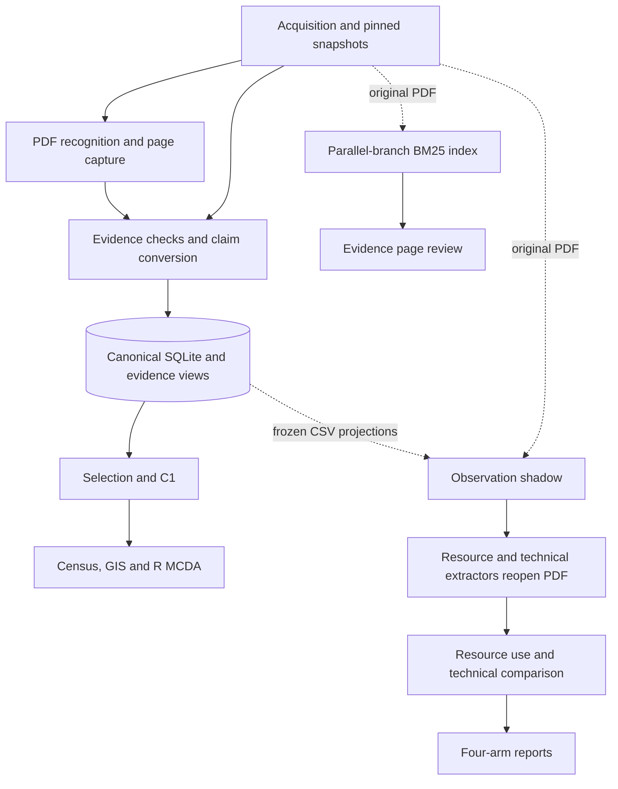
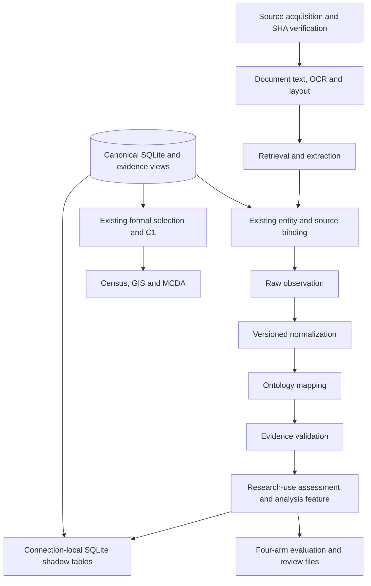

# 統一觀測資料契約與語義流程

## 開發基準

以 `feat/observation-semantics-shadow-20261126` 的 `bd6d95d` 為基準。PR #17 接續 #16 與 #15，並承接整合證據模型 #13。GitHub 對該次提交完成 Python、R、凍結重建及乾淨公開資料建置。[PR #17](https://github.com/lleeoo0611-stack/AU_REE_V2/pull/17) · [研究重建](https://github.com/lleeoo0611-stack/AU_REE_V2/actions/runs/45809715236) · [乾淨建置](https://github.com/lleeoo0611-stack/AU_REE_V2/actions/runs/45809715178)

| 既有分支 | 核對時的提交 | 已有能力 |
|---|---|---|
| `feat/integrated-evidence-model-20261120` | `25c2157` | SQLite 證據關係、聲明版次、C1 與分析接線 |
| `feat/ontology-comparability-20261126` | `cc36d77` | 來源綁定的本體論與比較原型 |
| `feat/ontology-gain-validation-20261126` | `d993ebd` | 全 Census 資源候選、審查證據與四組對照 |
| `feat/observation-semantics-shadow-20261126` | `bd6d95d` | 資源與技術完整擷取、用途判定、正式離線重播驗收 |
| `test/phase22-normalization-20261125` | `76b429a` | BM25 檢索與 Census 配對實驗 |

`bd6d95d` 包含 `25c2157`。正規化試驗分支與 `bd6d95d` 於 `8b5ac86` 分岔，BM25 實驗及其標註留在該分支。`main` 當時指向最初提交 `a16df75`。[分支比較](https://github.com/lleeoo0611-stack/AU_REE_V2/compare/76b429a8449acd3f34a952b6dce2fa95a8a2a937...bd6d95d0f30f2cb00f0b7715b18ac833899cd17a) · [BM25 封存實驗](https://github.com/lleeoo0611-stack/AU_REE_V2/tree/76b429a8449acd3f34a952b6dce2fa95a8a2a937/results/nlp-census-ab-20261126)

## 重構前



- 文件層已有來源指紋、OCR、頁擷取與 `capture_documents` 快取。驗證、資源擷取及技術擷取仍各自打開 PDF。文字排序、版面區塊與表格網格也由各入口分別取得。OCR 證詞、PyMuPDF 原生文字和 pypdf 文字有各自的查核用途。[PDF 擷取](../src/au_ree_v2/pdf_extract.py) · [資源擷取](../src/au_ree_v2/semantic_resource.py) · [技術擷取](../src/au_ree_v2/semantic_technical.py)
- `evidence.normalize`／`transformation_issues` 檢查聲明及轉換關係。`resource_use` 驗證來源 token、已入庫值與公布值，另列描述性用途中允許的換算。`technical_tables` 管理儲存格、表頭、數值和量別。選值及技術擷取共用 `technical.py` 內的 `technical_compare` 函式。[證據核驗](../src/au_ree_v2/evidence.py) · [資源用途](../src/au_ree_v2/resource_use.py) · [技術表格](../src/au_ree_v2/technical_tables.py) · [技術比較](../src/au_ree_v2/technical.py)
- SQLite 的 `observations` 已有穩定的 `obs_id` 和 `entity_id`、來源 SHA、原始 JSON、聲明、範圍、定位及轉換版本。`evidence_model` 已提供資源事實與版次、關係時間、技術試驗及公司／產品揭露的讀取 View。各讀取格式對原始欄位的命名與粒度不同，且既有觀測資料列只有一組數值和狀態。[SQLite](../src/au_ree_v2/store.py) · [證據讀取模型](../src/au_ree_v2/evidence_model.py)
- `observation_semantics` 已能分用途回傳判定、理由、證據及缺項。`ontology` 的 SKOS／QUDT 對照與 RDF／SHACL 原型、影子用途規則、正式 C1 和 MCDA 分屬不同入口。資源成對關係及技術用途的結論原先從各自的字典格式讀取。[影子規則](../src/au_ree_v2/observation_semantics.py) · [本體論原型](../src/au_ree_v2/ontology.py) · [正式選值](../src/au_ree_v2/selection.py) · [分析](../src/au_ree_v2/analysis.py)

以套件內 `.py` 檔案為節點、不同模組間的 AST 內部匯入為邊，並計入函式內匯入，基準有 **51 個模組、180 條邊、0 個循環**。`cli.py` 連到 25 個模組，兼管取得、建庫、研究出表與影子調度。正式工作流目前也需要以 `rebuild` 保持歷史快照相容。[循環測試](../tests/test_module_dependencies.py) · [重建工作流](../.github/workflows/research.yml)

## 重構後



| 層級 | 新的介面或重用點 |
|---|---|
| 文件處理 | `document_processing.PdfDocumentCache` 以 SHA 核對原件，在同次擷取共用已開啟的 PDF、文字順序、區塊、字詞及表格視圖。原生解析器差異及 OCR 的來源、方法、模型指紋另有記錄。既有 `pdf_extract` 仍提供 OCR 及表格規則。 |
| NLP 與實體連結 | `nlp.PageIndex` 集中 BM25 排序，資源與技術擷取共用文件讀取和既有儲存格規則。已快取的辨識報告可另讀取為帶定位的資源、稀土組成、技術和事件候選。候選資料的 Project、SHA、實體頁、表列定位和引文共同連回來源。既有身分資料由 `store`／`hierarchy` 及正式選用鏈提供。 |
| 觀測契約 | `observation_schema` 的 `observation-v1` 以不可變 Python 型別分開 Raw Observation、Normalized Observation、Semantic Assessment、Validated Observation 及 Analysis Feature。`observation_pipeline` 將來源候選及既有資源事實 View 轉成同一資料契約。 |
| 正規化 | 數值 token、同量綱換算與元素／氧化物係數集中於 `normalization`，由資源用途、既有化學換算和新觀測流程共用。公式的適用性仍取決於已知量別、範圍、材料、化學基準和分母。 |
| 本體論與查核 | `ontology` 共用詞彙對照和語境比較；`observation-v1` 詞彙補足資源分類、稀土物種、材料／分母及技術流程／尺度。既有 JORC、EarthResourceML、SKOS 和 QUDT 定義可同時支援 RDF／SHACL 實驗及本地精確詞彙查詢。 |
| SQLite | 既有 `observations`、Entity ID 及證據 View 為正式來源。`observation_store` 在唯讀連線的暫存表驗證外鍵、轉換版次、用途與規則版次。同一規格重跑須有相同內容，整批寫入失敗會回滾。影子期間保存的結果由 JSONL 匯出。 |
| 研究用途 | 證據狀態與用途可比性分欄，擷取證據、理由、缺項及規則版本可逐筆查核。正式 C1 仍由已版本化的六項 Eligibility Gate 與正式選值決定。影子四組結果經獨立入口輸出。 |

專案、礦床、來源聲明與其原始數值是觀測的身分及脈絡。`RawObservation` 可容納來源受阻或缺量值的候選。`NormalizedObservation` 以原始 ID、轉換版本、數值、單位、公式和條件鏈回來源。`ValidatedObservation` 要求證據驗證及正規化版本相符，`AnalysisFeature` 再要求該用途判為可比。SQLite 正式 Schema 的 `user_version` 為 1，新增的型別契約版本為 `observation-v1`。連線局部的影子表在關閉連線時釋放，歷史資料及影子結果分別由正式 SQLite 與評估匯出查詢。

## 驗證輸入與重建界線

- 凍結 Phase 22 的日期為 2026-11-05。`rebuild --snapshot-lock results/phase22-2026-11-06/snapshot_lock.json` 和 `tools/check_replay.py` 核對該歷史研究流程，其中包含 Python／R 回歸。93 個專案的 Census 使用 2026-11-13 截日及獨立的 `all --source-mode offline` 入口。[凍結 Phase 22](../results/phase22-2026-11-06/README.md) · [Census 重播](../results/ree-project-census/coverage-locked-20261125/README.md)
- 93 個 Census Project、351 筆資源候選與 381 筆技術觀測的歷史影子組，以候選清單、凍結的 Census／技術投影、證據政策與文件家族分組的雜湊固定。正式 Census `coverage-locked-20261125` 的來源收據對應由保管人提供的 715 份、約 1.51 GB 原件。對照此次 checkout 的 `data` 與 `results` 檔案內容，取得 542 個相同 SHA，包括 Salazar 與 Dubbo 原件。再從封存收據網址取回 115 份指紋相同的原件，合計 657／715。餘下 55 份取得內容指紋不符、3 份請求失敗。完整離線重播仍缺 58 份，正式入口在首個缺件停止。[影子比較與命令](../results/observation-shadow-20261126/README.md) · [原件清單](../results/ree-project-census/coverage-locked-20261125/asset_manifest.json) · [套件收據](../results/ree-project-census/coverage-locked-20261125/bundle_verification.json)
- 正式回歸核對 Project ID、Census、C1 閘門及 16 組面板。SQLite 大表逐列比較時，原件存放路徑、取得收據、執行時間需從科學資料變動中辨明。基準提交的驗收紀錄列出了兩次重播的輸出 SHA 以及 618 筆來源路徑與四份回應收據後設資料差異。[歷史驗收](../results/observation-shadow-20261126/verification.json)
- 獨立品質驗證以文件家族分組，保留首次抽樣的 8 頁與封存標註模板。獨立真人尚未填寫的精確率、召回率、F1、錯誤接納與錯誤排除需維持未量測。先前 BM25 的命中計數以暫定證據頁參照衡量候選檢索，分母為有參照且可評分的問題。[來源盲審](../results/observation-shadow-20261126/review_protocol.md) · [歷史 BM25 設計](https://github.com/lleeoo0611-stack/AU_REE_V2/blob/76b429a8449acd3f34a952b6dce2fa95a8a2a937/results/nlp-census-ab-20261126/protocol.md)

Python、R 與凍結 Phase 22 可在同一工作樹以以下命令重跑。

```sh
python -m unittest discover -s tests -v
Rscript tests/test_methods.R
python -m au_ree_v2 rebuild --as-of 2026-11-05 \
  --snapshot-lock results/phase22-2026-11-06/snapshot_lock.json --work work/unified-phase22
python tools/check_replay.py results/phase22-2026-11-06 work/unified-phase22/latest.json
```

## 研究用途

- Aim A 的準則與面板可透過型別契約追查數值、用途條件及採用證據。新增正式涵蓋須由既有面板資格及入選紀錄衡量。[Aim A 的共同樣本與排名](phase12-evidence-yield.md)
- Aim B 以固定母體和規則版次隔離擷取與判定的影響，可追查同一筆觀測跨組的保留、變更或缺項。權重、方法、分數、準則構成及樣本的敏感度仍由既有分析處理。[Aim B 的方法與敏感度](phase8-evidence-coverage.md)
- Aim C 可查詢以原文定位的樣品、給料、流程、尺度與量測條件。跨案解釋需先取得相容量測與充分的獨立專案。下一輪優先完成既有資源盲審頁標註，並封存此前未用於調整規則的技術文件家族。[Aim C 的技術證據](phase16-technical-model.md) · [盲審缺口](../results/observation-shadow-20261126/review_protocol.md)

## 四組對照與頁面檢索

93 個專案、351 筆資源候選和 381 筆技術觀測保持同一截日及候選框架。下表計算固定用途的判定通過紀錄。同筆原件的額外擷取表示仍只算一個獨立觀測。型別契約的證據、正規化及用途可比性紀錄另存於逐筆輸出，供核對相同用途的完整條件。

| 擷取 / 判定 | 凍結擷取重播的資源通過 | 38 份原件重讀的資源通過 | 技術用途通過 |
|---|---:|---:|---:|
| E0V0 | 88 | 88 | 269 |
| E1V0 | 88 | 50 | 269 |
| E0V1 | 88 | 88 | 269 |
| E1V1 | 90 | 52 | 269 |

凍結擷取重播保留 78 個去重後資源觀測、80 個專案欄位、37 個有可用值的專案及 179 對描述性配對。E1V1 的兩筆額外接受均為 Salazar 已有印刷儲存格的佐證；Dubbo 的 269 個技術格新增來源綁定的流程語境。以原件重讀時，232／274 筆合資格資源候選與 270／270 筆技術重讀候選的原件可得。232 筆資源結果與凍結擷取相同；19 個資源 SHA 缺件涵蓋 42 筆候選，其中 38 筆為原先通過紀錄。資源接納差異需按來源覆蓋解讀。[歷史逐筆基準](../results/observation-shadow-20261126/README.md)

在已取得原件、可以配對比較的資源候選子集，四組依 E0V0／E1V0／E0V1／E1V1 順序為 50／50／50／52。觀測層的新增獨立數值、新增可比觀測組與新增可比專案皆為 0。凍結和原件重讀分別有 97／351 和 92／351 筆資源候選具備原文定位、數值、單位及用途所需語境，技術皆為 269／270。對具備 token 與單位的 E1 候選，資源可正規化 66／102（凍結）與 63／97（重讀），技術皆為 374／381。型別用途輸出要求同時具備可核驗原文、已正規化數值及用途可比性，凍結和重讀分別輸出 22 和 19 筆資源用途特徵，技術皆為 269 筆。這些是候選表示的計數。E0V1 使用封存擷取，其用途判定仍可沿用既有規則及證據，型別層未宣稱已重讀原件。[消融比較程式](../src/au_ree_v2/observation_ablation.py)

以封存排名重計原 BM25 試驗，所標示相關頁的 Hit@5 由 24／49 升至 31／49。新共用檢索在可取得且 SHA 相符的 126／166 份留出 PDF 重排所有 53 題，共 5,232 個實體頁、5,225 頁有可搜尋文字。可評分問題的 Hit@5 為 22／40（55%）至 30／40（75%），送審頁次為 26 至 265，8／53 個擴充排序完全重現。完整和縮減語料的 IDF、候選集及分母各依該版本計算。獨立真人精確率、召回率、F1 與審查時間尚未量測。[歷史檢索試驗](https://github.com/lleeoo0611-stack/AU_REE_V2/tree/76b429a8449acd3f34a952b6dce2fa95a8a2a937/results/nlp-census-ab-20261126) · [重播工具](../tools/replay_bm25.py)

## 擷取成本與相依性

以同一份 38 個 SHA 命名原件、同一組 351／381 候選、同一 PyMuPDF 1.26.7 和相同 Linux Python 環境，比較 `bd6d95d` 的兩個分開擷取器，以及共用快取的 `extract_bound_observations`。每次以獨立程序測量，第二輪反轉執行順序。計時範圍為 E1 擷取，RSS 為該程序峰值，兩輪背景負載由環境決定。

| 指標 | `bd6d95d` | 共用文件快取 |
|---|---:|---:|
| PDF 開啟 | 38 | 37 |
| 原生順序文字讀取 | 137 | 136 |
| 表格解析 | 71 | 71 |
| E1 耗時，兩次 | 29.99、26.49 秒 | 21.99、22.40 秒 |
| 峰值 RSS，兩次 | 134.16、134.05 MiB | 145.24、145.22 MiB |

兩端輸出的 351 筆資源候選和 381 筆技術候選分別具有相同 SHA。一次跨構面重用省下一次原件開啟及同頁文字讀取。共用快取保留文字與版面視圖，峰值 RSS 隨之增加約 11 MiB。

以相同 AST 方法計算，套件由 51 個模組、180 條內部匯入邊變為 58 個模組、209 條邊，循環維持 0。數值解析與換算係數的重用減少跨語義與核驗模組的重複規則。忽略 docstring、以至少 16 個 AST 節點的跨模組函式比較，精確重複函式仍為一對空間 JSON 讀取函式。執行使用原有 Python、SQLite、PDF 解析套件及 R，RDF／SHACL 仍使用原有選用依賴。必裝套件增加 0 項。[相依循環測試](../tests/test_module_dependencies.py) · [套件依賴](../pyproject.toml)

## 重跑方式

```bash
python -m au_ree_v2 semantic-ablation --shadow-output work/observation-frozen
python -m au_ree_v2 semantic-ablation --shadow-originals "$ASSETS" \
  --shadow-output work/observation-reread
python -m au_ree_v2 semantic-ablation --database "$CANONICAL_SQLITE" \
  --shadow-output work/observation-staged
python -m au_ree_v2 semantic-shadow --unified-observations \
  --shadow-run "$PHASE22_FORMAL_RUN" --shadow-originals "$ASSETS" \
  --shadow-output work/observation-from-formal
python -m tools.observations_from_recognition --report "$CACHED_RECOGNITION_REPORT" \
  --out work/recognition-observations.jsonl
```

`semantic-ablation` 無原件參數時會重算凍結擷取的全部用途規則。有原件參數時重新提取 E1，並保留同一母體及明列原件缺口。`--database` 對現有 canonical SQLite 執行唯讀連線暫存驗證。正式輸出完成後可由 `all --semantic-shadow --unified-observations` 進入同一比較流程，該路徑會先核對正式投影。請使用與 `shadow_profiles_v1.json` 指紋相符的 Census／技術輸出。[比較入口](../src/au_ree_v2/observation_ablation.py) · [型別暫存](../src/au_ree_v2/observation_store.py)

以 152 份已快取的辨識報告驗證投影介面，成功輸出 692 筆資源、16 筆策略成分、1,973 筆技術及 4,983 筆事件提及的原始候選。計數包含各報告版次及其候選資料。同一來源的報告可包含同一觀測的多個表示。這些結果提供定位與審查清單，觀測數值是否有效仍取決於來源、量別及用途判定。[辨識投影](../tools/observations_from_recognition.py)

## 正式回歸

使用同一份 2026-11-05 快照，在基準與開發版各自建立 SQLite 並執行 R。455／455 個由程式記錄的輸出指紋完全相同，涵蓋 Census、Eligibility、16 組 MCDA 面板。歷史 `check_replay.py` 的 64 份研究表格亦通過。兩個 SQLite 的邏輯資料指紋相同，以 `293218a2` 開頭。正式 Schema 相同，`PRAGMA integrity_check` 回傳 `ok`，`foreign_key_check` 為空。歷史來源、觀測及關係逐列相同。執行 ID、時間和程式版次等 run 後設資料依執行變動。11-02 的另一次凍結建置也有 135／135 個輸出指紋與邏輯資料指紋相同。[Phase 22 鎖檔](../results/phase22-2026-11-06/snapshot_lock.json) · [重建核對](../tools/check_replay.py)

以 93 專案正式封存檔核對 19 個公布指紋，包括 Census、兩項 C1 檔案及 16 份排名。93 個 Project ID 唯一且集合指紋與基準相同。這項核對限於封存檔，正式 93 專案端到端重建待補齊原件。以正式 Phase 22 SQLite 的 820 筆資源事實測試型別投影與重複匯入，得到 820 個可定位的 Canonical Observation ID 和 820 個暫存原始記錄。暫存及正式外鍵檢查皆無錯誤，SQLite 檔案 SHA 相同。[93 專案封存](../results/ree-project-census/coverage-locked-20261125/README.md) · [SQLite 契約測試](../tests/test_observation_schema.py)
